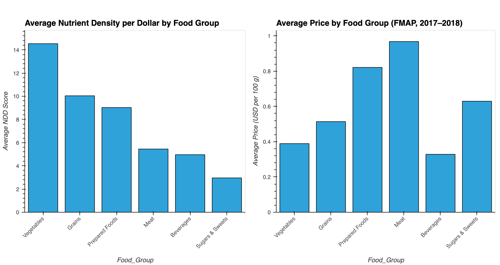
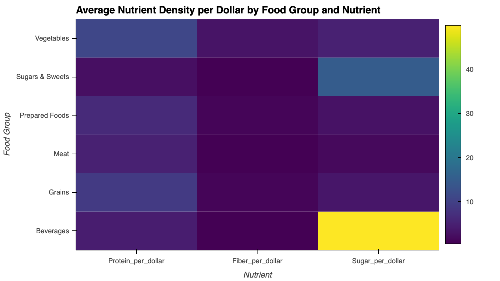
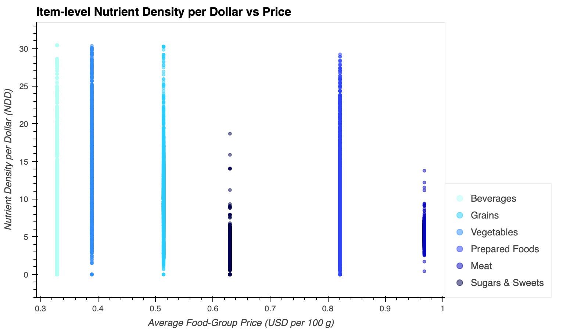

# Is Healthy Food Really More Expensive?

**Nutrient Density per Dollar across food groups, using NYC MenuStat and USDA data**

Many people assume that eating well costs more. This project tests that belief by combining restaurant nutrition data with USDA food price data and dietary benchmarks. It introduces an original metric, the **Nutrient Density per Dollar (NDD) score**, to compare how much nutrition each food group delivers for its price.

*Data visualization course project, Rutgers University (2025).*



## Key findings

- **Vegetables gave the most nutrition per dollar.** They had the highest average NDD score while keeping a relatively low average price.
- **Grains were a cost-effective middle ground**, with moderate nutrient density at modest prices.
- **Meats had the highest average prices** but only moderate NDD, so nutritional returns shrink relative to cost.
- **Sugars & sweets and beverages performed worst**, with low protein and fiber per dollar and most of their nutrient value coming from sugar.
- **Bottom line:** within this analysis, nutrient-dense eating does not inherently require higher food costs. Choosing the right food groups matters more than spending more.



## Data

| Dataset | Source | What it provides |
|---|---|---|
| MenuStat (Historical) | [NYC Open Data, NYC DOHMH](https://data.cityofnewyork.us/d/qgc5-ecnb) | Calories, protein, fiber, sugar, sodium, and food category for restaurant menu items |
| Food-at-Home Monthly Area Prices (F-MAP) | [USDA Economic Research Service](https://www.ers.usda.gov/data-products/food-at-home-monthly-area-prices) | Average retail unit prices (USD per 100 g) for 90 food groups |
| Table 8, recommended and 2017–18 densities | [USDA ERS, Food Consumption, Nutrient Intakes, and Diet Quality](https://www.ers.usda.gov/data-products/food-consumption-nutrient-intakes-and-diet-quality) | Recommended nutrient and food-group densities per 1,000 kcal |

The raw files are not stored in this repository. See [`data/README.md`](data/README.md) for download steps and expected filenames.

## Method

1. **Clean** MenuStat items, keeping those with calories, protein, and fiber.
2. **Map** MenuStat categories (for example, Burgers, Salads, Pizza) and F-MAP food groups into shared broad groups: Vegetables, Grains, Meat, Prepared Foods, Sugars & Sweets, Beverages, and Other Foods.
3. **Price** each group using the average 2017–2018 F-MAP unit price.
4. **Compute nutrient density** per 100 kcal for protein, fiber, sugar, and sodium.
5. **Score** each item:

   `NDD = (protein per 100 kcal + fiber per 100 kcal) / average food-group price`

6. **Visualize** results with interactive HoloViews/Bokeh charts: NDD and price by group, a nutrient-per-dollar heatmap, an item-level scatterplot, and a fiber comparison with USDA Table 8.



## Limitations

- **Prices are at the food-group level**, so every item in a group shares the same price. Differences within a group reflect nutrient content, not price.
- **Different bases:** nutrients are per 100 kcal, while F-MAP prices are per 100 g of food, so NDD is a relative index for comparing groups.
- **Restaurant items are paired with grocery prices.** MenuStat covers restaurant menu items, and F-MAP covers food-at-home retail prices.
- **Category mapping was done by hand** (for example, Fried Potatoes and Salads to Vegetables). Other mapping choices could change the rankings.
- **NDD counts protein and fiber only.** It does not penalize sodium, added sugar, or saturated fat.
- **Table 8 units differ:** the food-group recommendations are in cup- or ounce-equivalents per 1,000 kcal, so the fiber comparison (Figure 6) is descriptive only.

## Repository structure

```
├── Food_Cost_vs_Nutrition.ipynb   # Full analysis, figures, and write-up
├── food_utility.py                # Loading, cleaning, mapping, and NDD functions
├── requirements.txt
├── data/
│   └── README.md                  # Where to download each dataset
└── images/                        # Static copies of key figures
```

## How to run

Requires Python 3.10 or newer.

```bash
git clone https://github.com/<your-username>/food-cost-vs-nutrition.git
cd food-cost-vs-nutrition
pip install -r requirements.txt
# Download the three data files into data/ (see data/README.md)
jupyter lab Food_Cost_vs_Nutrition.ipynb
```

To view the interactive charts without running anything, open the notebook in [nbviewer](https://nbviewer.org/).

## Tools

Python, pandas, NumPy, HoloViews, Bokeh, Jupyter

## Author

**Precious Akinde**, M.S. Computational and Integrative Biology, Rutgers University
[LinkedIn](https://www.linkedin.com/in/pakinde)
